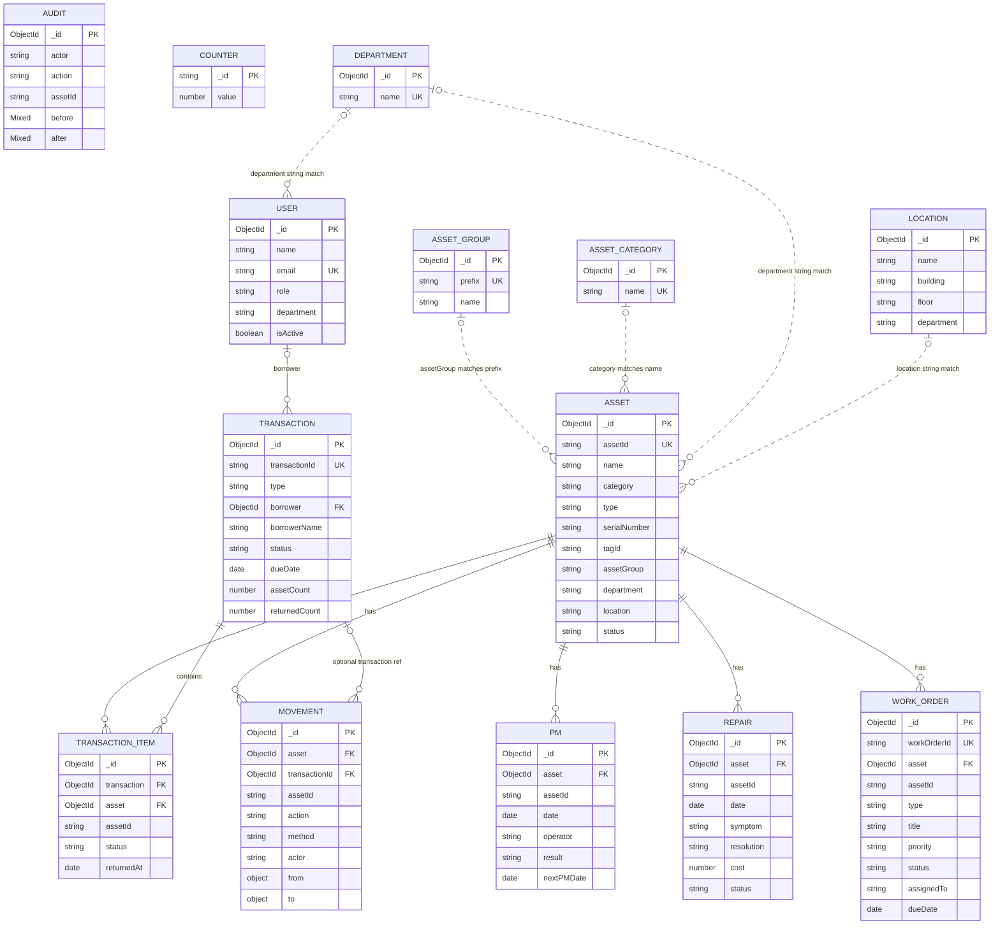

# Smart ITAM ER Diagram

This diagram reflects the MongoDB/Mongoose models in `backend/src/models.js`.
`_id` is MongoDB's primary key unless marked otherwise. Fields shown are the
main identifiers and relationship fields; timestamps and less central fields
are omitted for readability.

Rendered vector image: [ER_DIAGRAM.svg](ER_DIAGRAM.svg).

## Relationship notes

- Solid relationships are Mongoose `ObjectId` references declared with `ref`.
- Dashed relationships are logical matches between strings. The schema does
  not enforce them as foreign keys, so values can exist without a matching
  catalog record.
- `Transaction.borrower` is an optional `User` reference. Transactions also
  store `borrowerName` as a snapshot string.
- `Movement.transactionId` is an optional reference; movement records also
  store `assetId` as a denormalized string. Its `from` and `to` objects each
  hold `floor`, `department`, and `location` strings.
- `TransactionItem` is the join collection between transactions and assets.
- `PM` means preventive maintenance. Its checklist and work-order checklists
  are embedded arrays, not separate collections.
- `Audit.assetId` is a string rather than an `Asset` reference. `Counter` is
  an independent string-keyed collection used to generate identifiers.
- The model schemas use `createdAt` and `updatedAt` timestamps, except
  `Counter`.
